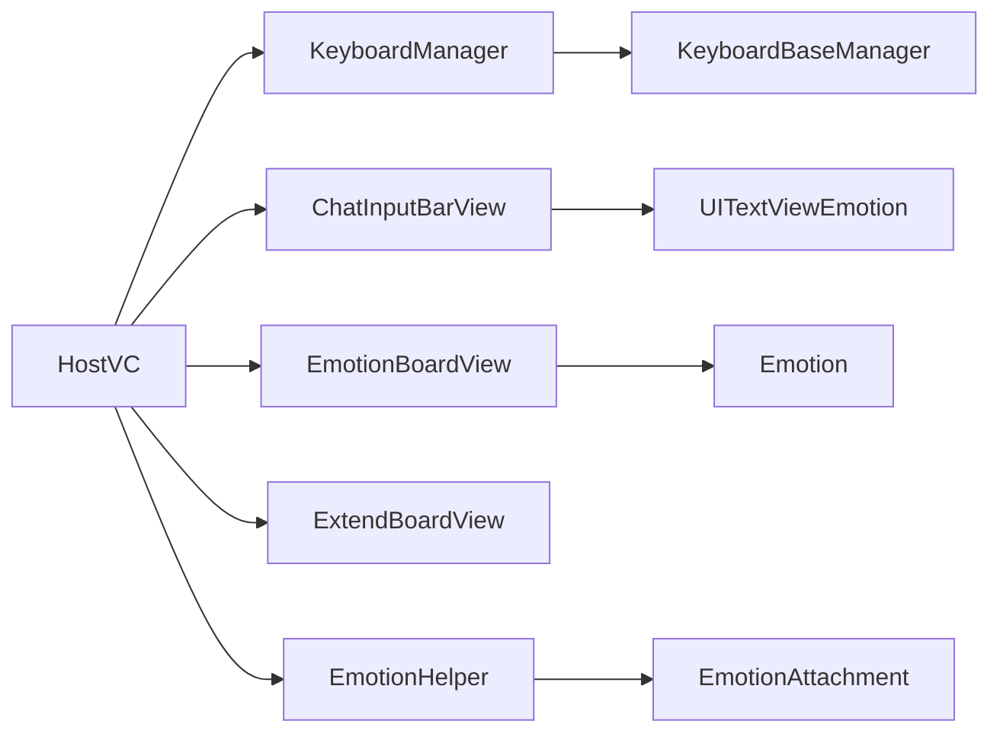

# ZHHChatKeyboard

纯 Swift 聊天底部输入区：系统键盘 / 表情面板 / 扩展面板平滑切换，支持标准与胶囊布局。

- 最低系统：iOS 15.0  
- 分发：CocoaPods + Swift Package Manager  
- 依赖：仅 UIKit / Foundation  

## 架构



状态机：`normal` ↔ `text` ↔ `emotion` ↔ `extend`。仅在 `text` 状态响应系统键盘布局，避免与手动面板动画冲突。

## 安装

### CocoaPods

```ruby
pod 'ZHHChatKeyboard'
```

### SPM

Xcode → File → Add Packages… → 填写仓库 URL。

## 最小接入

```swift
let height = ChatInputBarView.preferredMinHeight(for: .default())
let inputBar = ChatInputBarView(frame: CGRect(x: 0, y: 0, width: view.bounds.width, height: height))
inputBar.setup(with: .default())
inputBar.delegate = self

let manager = KeyboardManager(viewController: self)
manager.dataSource = self
manager.delegate = self
manager.addBottomChatInputBarView(inputBar, belowViewController: false)
manager.bindTextView(inputBar.inputTextView)
```

侧滑返回时：

```swift
override func viewWillDisappear(_ animated: Bool) {
    super.viewWillDisappear(animated)
    keyboardManager.viewControllerWillDisappear = true
}
```

输入条配置用 `ChatInputBarConfiguration`（`default()` / `capsuleLeading()` / `capsuleTrailing()`），大改结构请 `replaceChatInputBarView`，仅改外观可用 `updateChatInputBarAppearance`。

## Example

```bash
cd Example
pod install
open ZHHChatKeyboard.xcworkspace
```

入口按库能力分组：标准、胶囊（左 / 右）、聊天场景、其他（评论栏、TextField 工具条、深色模式等）。

## 主要类型

| 类型 | 职责 |
|------|------|
| `KeyboardManager` | 会话级键盘 / 面板状态机与布局 |
| `KeyboardBaseManager` | 宿主挂载与安全区等基础能力 |
| `KeyboardManagerDataSource` / `Delegate` | 面板提供与高度回调 |
| `ChatInputBarView` / `ChatInputBarConfiguration` | 输入条与配置 |
| `ChatInputTextView` | 默认输入框（占位 / 可选字数上限） |
| `Emotion` / `EmotionAttachment` / `EmotionHelper` | 表情模型与图文互转 |
| `EmotionBoardView` | 表情面板 |
| `ExtendBoardView` / `ExtendBoardItem` | 扩展面板 |

## 表情 / 更多数据（务必阅读）

库**不内置可商用表情资源**。Example 中的 `ic_emoji_*` 仅供演示，**不可用于正式产品**。

推荐在 `KeyboardManagerDataSource` 中一并提供面板 View 与数据（Manager 会在创建面板时自动注入，并配置本会话 `emotionHelper`）：

```swift
extension ChatViewController: KeyboardManagerDataSource {
    func keyboardManagerEmotionBoardView(_ manager: KeyboardManager) -> UIView? { EmotionBoardView() }
    func keyboardManagerExtendBoardView(_ manager: KeyboardManager) -> UIView? { ExtendBoardView() }

    func keyboardManagerEmotionGroups(_ manager: KeyboardManager) -> [EmotionGroup] {
        [
            EmotionGroup(identifier: "default", title: "表情", style: .emoji, emotions: myEmotions)
        ]
    }

    func keyboardManagerExtendBoardItems(_ manager: KeyboardManager) -> [ExtendBoardItem] {
        [
            ExtendBoardItem(icon: UIImage(named: "pic"), title: "相册"),
            ExtendBoardItem(icon: UIImage(named: "camera"), title: "拍摄")
        ]
    }
}
```

也可直接对面板调用 `emotionBoard.update(groups:)` / `extendBoard.update(items:)`。

## License

MIT
